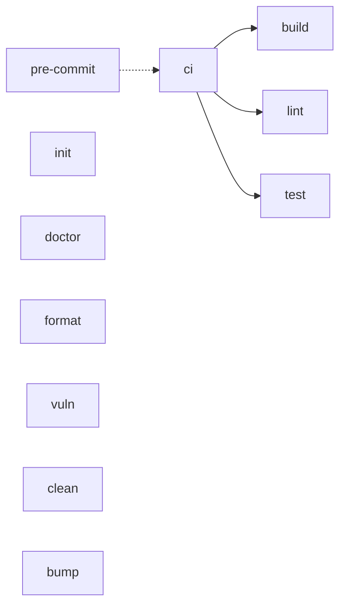

# Makefile Reference

The [`Makefile`](./Makefile) is the single source of truth for building, linting
and testing ghx. Humans, agents and CI run the same targets, so a green
`make ci` locally means the same checks CI runs. Run `make help` for the quick
target list; this file is the narrative reference.

## Target overview

Solid arrows are hard prerequisites, run in order (`build`, then `lint`, then
`test`). The dotted arrow is an alias (`pre-commit` runs `ci`). The remaining
targets stand alone.

## Targets

### Develop

| Target | Description |
|--------|-------------|
| `help` | List targets (the default goal) |
| `init` | `go mod download`; `INSTALL_PACKAGES=1` also installs golangci-lint |
| `doctor` | Check the dev environment with `triage` against `triage.yaml`; `MODE=default\|release` |
| `build` | `go build -ldflags "-X ..." -o bin/ghx ./cmd/ghx`, stamped with the build version (below) |
| `lint` | gofmt drift, `go mod tidy -diff`, `go vet`, `golangci-lint run`; fails when golangci-lint is missing |
| `format` | `gofmt -w .`, `golangci-lint fmt` (when installed), `go mod tidy` |
| `test` | `go test -race -cover ./...` |
| `vuln` | `go tool govulncheck ./...` (govulncheck is a `tool` dependency in `go.mod`) |
| `ci` | `build`, `lint`, `test`: the full pre-push gate |
| `pre-commit` | Alias of `ci` |
| `clean` | Remove `bin/` and `dist/` |

### GitHub

| Target | Description |
|--------|-------------|
| `gh-runs-list` | List in-flight Actions runs (`status != completed`) |
| `gh-runs-watch` | Watch in-flight runs until each completes |
| `gh-runs-status` | Last completed run per workflow: `success` is a green check, `skipped` and `neutral` a dim dash, anything else a red cross |

`GH_LIMIT` (default 50) caps how many recent runs are fetched. A `gh` failure
(for example, not logged in) prints a warning and exits 0.

### Release

| Target | Description |
|--------|-------------|
| `bump` | `python3 scripts/bump_version.py $(LEVEL)`: rewrites `version.txt` and moves the `CHANGELOG.md` `## [Unreleased]` entries under a `## [vX.Y.Z] - date` heading. `LEVEL=patch\|minor\|major` is required; `DRY_RUN=1` adds `--dry-run`, which prints what would change and writes nothing. It neither commits nor tags |

`scripts/bump_version.py` is the `personal-release` skill's template, copied
unchanged; update it by copying the template again, not by editing it here.

## The build version

`make build` stamps three values into `internal/buildinfo` with `-ldflags -X`,
and `ghx --version` prints them as `ghx <RELEASE>+<SHA> (<BUILD_CODE>)`, the
versioning standard's form:

| Variable | Source |
|----------|--------|
| `RELEASE` | [`version.txt`](./version.txt): the last released version, which only a release rewrites |
| `SHA` | `git rev-parse --short HEAD`, plus `.dirty` when `git status --porcelain` reports anything, untracked files included |
| `BUILD_CODE` | `git rev-list --count HEAD`; a shallow clone undercounts, so a release checkout needs full history (`fetch-depth: 0`) |

Outside a git checkout `SHA` and `BUILD_CODE` are empty and the binary prints
`ghx <RELEASE>`. A build that skips the Makefile (`go build`, `go run`,
`go install`) prints `ghx dev`.

Release builds use the same three values instead of computing their own:
goreleaser stamps `{{ .Env.RELEASE }}`, `{{ .Env.SHA }}` and
`{{ .Env.BUILD_CODE }}`, and runs only through Makefile targets that put the
Makefile's values in its environment, so a local build and a release build of
one commit print the same string.

## `make init`: idempotent bootstrap

`make init` is safe to re-run at any time. It runs `go mod download`. With
`INSTALL_PACKAGES=1` it also installs golangci-lint at `GOLANGCI_LINT_VERSION`
into `$(go env GOPATH)/bin`, but only when `golangci-lint` is not already on
`PATH`. It never touches an existing install.

## `make doctor`

Read-only. Runs `triage` against [`triage.yaml`](./triage.yaml), which checks
`git`, `go` (against the version in [`.go-version`](./.go-version)), `gh` and
`golangci-lint`. `MODE=release` adds `goreleaser`. A missing tool is a reported
result from triage, not a Makefile error. Install triage with
`brew install lolay/tap/triage`.

## `make lint` and `make format`

`format` rewrites source formatting and `go.mod` / `go.sum`; `lint` has a
check-only twin for each, so a commit made without `make format` fails CI.
Lint rules live in [`.golangci.yml`](./.golangci.yml), whose header lists the
linters left out for now and why. `GOLANGCI_LINT_VERSION` in the Makefile is
the pinned version; the CI install step must use the same value.

## CI map

[`.github/workflows/ci.yml`](./.github/workflows/ci.yml) runs on every push and
on every pull request, one run per ref (a newer push cancels the run it
supersedes), with read-only `contents` permission. It has three jobs, one per
operating system, and each job name shows its OS.

| Job | Runner | Runs |
|-----|--------|------|
| `build, lint, test, vuln (linux)` | `ubuntu-latest` | `go mod verify`, golangci-lint install, `make ci`, `make vuln` |
| `build, lint, test (macos)` | `macos-latest` | golangci-lint install, `make ci` |
| `build, vet, test (windows)` | `windows-latest` | `go build ./...`, `go vet ./...`, `go test ./...` under `shell: bash` |

Windows runs the Go commands directly rather than `make ci`: `make test` uses
`-race`, and the race detector needs cgo, which the Windows runner lacks.

The golangci-lint install step in `ci.yml` reads its version from the workflow's
`GOLANGCI_LINT_VERSION`, which must equal `GOLANGCI_LINT_VERSION` in the
Makefile. Bump both together.
