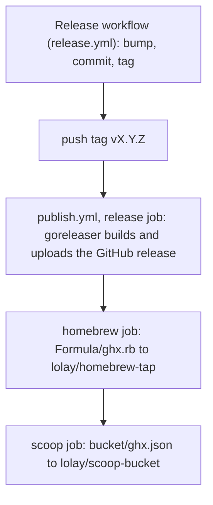

# Releasing ghx

Maintainer guide for cutting a release of the `ghx` CLI on `lolay/ghx`. Users:
[`README.md`](../README.md). Contributors: [`CONTRIBUTING.md`](../CONTRIBUTING.md).
The target reference is [`Makefile.md`](../Makefile.md).

## Core rule: remote pushes happen last

Everything that can fail locally (compile, the cross-build matrix, archives,
checksums) must succeed before anything goes live. The remote pushes then run in
a fixed order, each only after the one before it succeeded, so a failure leaves
the smallest possible blast radius:



| Order | What | Where | Run by |
|-------|------|-------|--------|
| 0 | `version.txt` and `CHANGELOG.md` bump, commit `release vX.Y.Z`, tag `vX.Y.Z` | `lolay/ghx` | `release.yml` (`scripts/bump_version.py`) |
| 1 | Build, archive and checksum every target, then upload the GitHub release | `lolay/ghx` | `publish.yml` `release` job: `make release` (goreleaser) |
| 2 | Homebrew formula | `lolay/homebrew-tap` | `publish.yml` `homebrew` job: `make publish-formula` (`scripts/publish-formula.sh`) |
| 3 | Scoop manifest | `lolay/scoop-bucket` | `publish.yml` `scoop` job: `make publish-scoop` (`scripts/publish-scoop.sh`) |

**Why this order.** The formula and the manifest point at
`releases/download/vX.Y.Z/...` URLs and carry the sha256 of each archive, so the
assets must exist first. The `homebrew` and `scoop` jobs render from the
`checksums.txt` on the published release, which
`scripts/fetch-release-checksums.sh` first checks is a published (not draft)
release holding every archive the file lists. They never name an asset that
isn't there. The jobs are chained with `needs:`, so a failed step stops the
ones after it.

## Versioning

[Semantic Versioning](https://semver.org/), tagged `vMAJOR.MINOR.PATCH`, with no
pre-release suffixes: every tag is a stable release. The rules are Gary's
versioning standard; this is how ghx applies them.

- **`version.txt` holds the last released version**, not the next planned one.
  Only the Release workflow rewrites it, at tag time, when the maintainer picks
  `patch`, `minor` or `major` (the lazy bump).
- **Dev builds read `<release>+<sha> (<buildCode>)`**, for example
  `ghx 0.1.0+abc1234 (42)`: the last release, then the short HEAD sha (`.dirty`
  appended when the tree has uncommitted changes), then the commit count
  (`git rev-list --count HEAD`). A tagged release prints the same shape, for
  example `ghx 0.2.0+def5678 (51)`. `make build` stamps it; a plain `go build`
  prints `ghx dev`. See "The build version" in [`Makefile.md`](../Makefile.md).
- **The release build and a local build of one commit print the same string.**
  goreleaser stamps the `RELEASE`, `SHA` and `BUILD_CODE` the Makefile
  computes, so the checkout must have full history (`fetch-depth: 0`): a
  shallow clone undercounts the build code. Both workflows check out that way.
- **Build metadata stays out of identities.** The archive names, the tag, the
  formula and the manifest carry the plain `X.Y.Z`; the `+sha` appears only in
  `ghx --version` and in snapshot archive names.

| Level | When |
|-------|------|
| `patch` | Bug fixes only |
| `minor` | A backward-compatible feature |
| `major` | A breaking change to the CLI, flags or config. On `0.x`, a breaking change may be a minor; say so in the changelog |

`version.txt` reads `0.1.0` before any release, and it is the last released
version, so the first release through the workflow is `0.1.1` (patch), `0.2.0`
(minor) or `1.0.0` (major), not `0.1.0`. `make bump LEVEL=<level> DRY_RUN=1`
shows what a level would produce.

## Pre-flight

On `main`, before dispatching the Release workflow:

1. **CI is green on the commit you are releasing.** The `ci` workflow passed on
   `main`'s HEAD, and `make ci` passes locally.
2. **`CHANGELOG.md`'s `## [Unreleased]`** describes what ships. The bump moves
   those entries under `## [vX.Y.Z] - date`; it does not write them.
3. **The release config is valid:** `make release-check`. For a full dry run,
   `make snapshot` builds the six archives and `checksums.txt` into `dist/`
   without publishing, and `DRY_RUN=1 scripts/publish-formula.sh <release>+<sha> dist`
   and `DRY_RUN=1 scripts/publish-scoop.sh <release>+<sha> dist` print the
   rendered formula and manifest without cloning or pushing, with the
   snapshot's version string from `dist/`.
4. **The level is right:** `make bump LEVEL=<level> DRY_RUN=1` prints the new
   version and writes nothing.
5. **The secrets exist** (see "Required secrets") and, for a first release, the
   checklist below is done.
6. **Dispatch from `main`**, or for a hotfix from a release line branch (see
   "Hotfixes").

## Cutting a release

Go to **Actions, Release, Run workflow**, keep the branch `main`, pick the
`level` (`patch`, `minor` or `major`) and click **Run workflow**.
[`release.yml`](../.github/workflows/release.yml) then:

1. Checks out the branch with full history and `RELEASE_TAG_PAT`.
2. Refuses unless the branch is `main`, `release/vX` or `release/vX.Y`.
3. Runs `scripts/bump_version.py <level>`, which rewrites `version.txt` and
   moves the Unreleased entries in `CHANGELOG.md`.
4. Refuses if the tag `vX.Y.Z` already exists.
5. Commits `release vX.Y.Z`, tags `vX.Y.Z` and pushes the branch and the tag.

The tag push starts [`publish.yml`](../.github/workflows/publish.yml) (the
Publish workflow), which runs its `release`, `homebrew` and `scoop` jobs in that
order. A push made with `GITHUB_TOKEN` would not start another workflow, which
is why `release.yml` pushes with `RELEASE_TAG_PAT`.

Watch it with `make gh-runs-watch`, and check `make gh-runs-status` afterwards.

### Re-running a failed publish

`publish.yml` runs once per tag and never cancels a run halfway. When a job
fails:

- **Re-run failed jobs** from the run's page re-runs only the job that failed
  and those after it. This is the usual fix for a flaky `homebrew` or `scoop`
  push.
- **Actions, Publish, Run workflow** with the `tag` input (`vX.Y.Z`, an existing
  tag) re-runs all three jobs. It is safe: the `release` job skips goreleaser
  when the GitHub release is already complete, and the publish scripts commit
  nothing when the file is already at that version.
- **A release left half uploaded** (the `release` job died after some assets):
  goreleaser can't upload an asset that is already there, and the release does
  not count as complete. Delete the incomplete GitHub release from the Releases
  page, **keeping the tag**, then dispatch Publish with the tag.
- **The tag check fails** (`version.txt` doesn't hold the tag's version): the
  tag was cut from a commit whose `version.txt` disagrees with it. Don't move
  a published tag; fix forward with a new release.

Never re-run the Release workflow to repair a publish: it would bump again.

### Hotfixes

To patch an old line, branch `release/vX` (a major line: patch or minor bumps
within `X.*`) or `release/vX.Y` (a minor line: patch bumps within `X.Y.*`) from
the tag, land the fix there, and dispatch Release with **Use workflow from** set
to that branch. The bump refuses a level that would leave the line.

Publishing a hotfix from an old line updates the tap and the bucket to that
version, which moves them **back** from the newest release, because each repo
holds one file for the latest version. To put them right, dispatch Publish with
the newest tag afterwards.

## Emergency local path

Use this only when the workflows can't run. The remote-mutating targets sit
under `##@ Danger` and refuse without their `CONFIRM_*` variable. There is no
`tag` target: tags normally come from the Release workflow.

```bash
# 1. Bump, commit and tag by hand, from a clean main with full history:
make bump LEVEL=patch            # rewrites version.txt and CHANGELOG.md
git commit -am "release vX.Y.Z"
git tag -a vX.Y.Z -m vX.Y.Z      # pushing the branch and the tag is outward-facing: confirm first
git push origin HEAD vX.Y.Z      # this starts publish.yml; stop here if the workflow works again

# 2. Or publish from the tag locally, in the same order:
git checkout vX.Y.Z
CONFIRM_RELEASE=1 make release
CONFIRM_PUBLISH_FORMULA=1 make publish-formula VERSION=X.Y.Z
CONFIRM_PUBLISH_SCOOP=1 make publish-scoop VERSION=X.Y.Z
```

`make release` needs `GITHUB_TOKEN` in the environment, `publish-formula` needs
`HOMEBREW_TAP_TOKEN` and `publish-scoop` needs `SCOOP_BUCKET_TOKEN`. They read
the checksums from `dist/`, which `make release` fills. A machine without
goreleaser passes
`GORELEASER="go run github.com/goreleaser/goreleaser/v2@v2.18.3"`. Don't push
the tag and also publish locally: `publish.yml` runs on the tag push.

## Required secrets

Three repository secrets on `lolay/ghx` (Settings, Secrets and variables,
Actions). The GitHub release upload uses the run's own `github.token`, which
needs no secret. A secret is read only through `secrets.<NAME>`, into the one
step that uses it, and never written to a file or a clone URL.

| Secret | Used by | Scope it needs |
|--------|---------|----------------|
| `RELEASE_TAG_PAT` | `release.yml` checkout, so its push can start `publish.yml` | Fine-grained PAT on `lolay/ghx`: Contents read and write. It must be able to push the release commit to `main` (and to a `release/*` branch) and the tag, so if a branch ruleset or protection requires pull requests, the token's owner needs bypass for it |
| `HOMEBREW_TAP_TOKEN` | `publish.yml` `homebrew` job, `scripts/publish-formula.sh` | Fine-grained PAT on `lolay/homebrew-tap` only: Contents read and write |
| `SCOOP_BUCKET_TOKEN` | `publish.yml` `scoop` job, `scripts/publish-scoop.sh` | Fine-grained PAT on `lolay/scoop-bucket` only: Contents read and write |

Give each token the one repository it needs and nothing else, and set an
expiry. The publish scripts commit as `ghx-release-bot` and hand the token to
`git` as an `http.extraheader` through its environment, so it is in no command
line, clone URL or `.git/config`, and mask its base64 form in the Actions
log, since Actions masks only the raw secret. To rotate a token, replace the secret's value
and re-run a failed publish.

## First-release checklist

Do these once, before the first Release dispatch:

- [ ] Create the three secrets above.
- [ ] Add a `ghx` row to the tables in the README of `lolay/homebrew-tap` and of
      `lolay/scoop-bucket`, as the existing tools have. The first release
      creates `Formula/ghx.rb` and `bucket/ghx.json` itself.
- [ ] Confirm `lolay/scoop-bucket` carries the `scoop-bucket` GitHub topic, so
      scoop.sh indexes it.
- [ ] Run `make release-check`, and `make snapshot` with the `DRY_RUN=1` publish
      scripts, as in the pre-flight.
- [ ] Dispatch Release from `main` and watch all three Publish jobs go green.
- [ ] Confirm `brew install lolay/tap/ghx` (after `brew trust lolay/tap`) works
      and that `ghx --version` prints the new release.
- [ ] Confirm `scoop bucket add lolay https://github.com/lolay/scoop-bucket`
      and `scoop install lolay/ghx` work on Windows.
- [ ] Remove the "available from the first release" note from the README's
      Install section.

## Post-release verification

1. The GitHub release on `lolay/ghx` holds six archives (`ghx_X.Y.Z_<os>_<arch>`,
   `.tar.gz`, and `.zip` on Windows) and `checksums.txt`.
2. `Formula/ghx.rb` on `lolay/homebrew-tap` and `bucket/ghx.json` on
   `lolay/scoop-bucket` name `X.Y.Z`.
3. `brew update && brew install lolay/tap/ghx` (or `brew upgrade ghx`) and
   `scoop update ghx` pick it up.
4. `ghx --version` prints `ghx X.Y.Z+<sha> (<buildCode>)` for the tag's commit.
5. `version.txt` on `main` holds `X.Y.Z`, and `CHANGELOG.md` has a
   `## [vX.Y.Z]` section.

## Distribution channels

| Channel | Status |
|---------|--------|
| Homebrew tap `lolay/tap/ghx` | Primary (macOS and Linux) |
| Scoop bucket `lolay/scoop-bucket` | Primary (native Windows) |
| GitHub Releases | Primary (all six targets) |
| `go install github.com/lolay/ghx/cmd/ghx@latest` | Works, but prints `ghx dev` |
